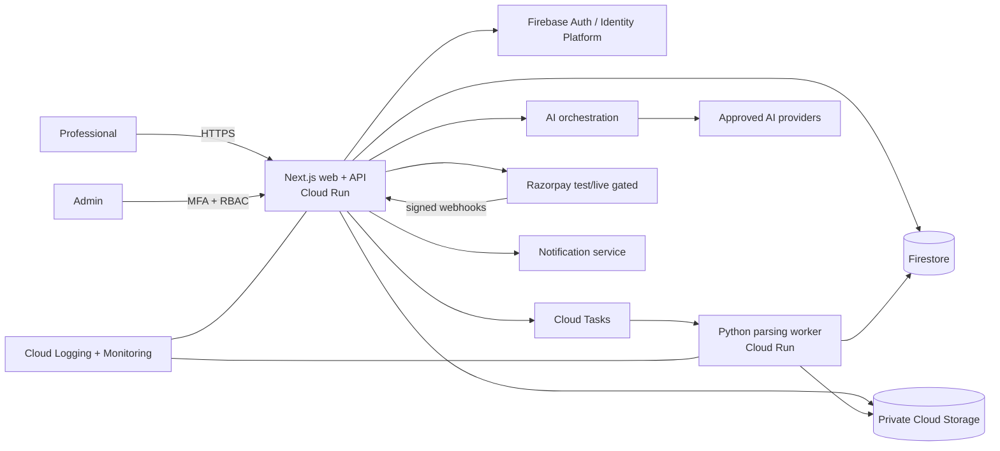

# Architecture

## Initial system context



## Repository shape

```text
apps/web                 Next.js public site, product UI, admin UI, API routes
services/parser          Phase 1 FastAPI parsing/OCR worker
packages/contracts       Shared Zod/OpenAPI contracts (Phase 1)
packages/domain          Framework-independent business rules (Phase 1)
infra/cloudrun           Service definitions
infra/cloudbuild         Build/deploy pipeline
infra/scripts            Auditable bootstrap scripts
docs                     Product and operating documentation
```

## Architectural boundaries

- UI calls typed application services rather than storage/provider SDKs directly.
- Domain policies—quotas, scoring, entitlements, payment state—remain deterministic and framework independent.
- Persistence is accessed through repositories, with Firestore implementations at launch.
- External providers sit behind auth, AI, payment, email, job-source, search, and notification ports.
- Async jobs are idempotent and record attempts, terminal outcomes, and replay metadata.
- Uploaded files are private; user-facing access uses short-lived signed URLs.

## Environments

- `dev`: local/emulated services and synthetic data.
- `staging`: separate Google Cloud project, test credentials, no production PII.
- `prod`: separate project, live integrations enabled only after Phase 6 gates.

Automated tests never target production. Secret values enter through Secret Manager or environment injection, never source control.

## Scalability and cost posture

- Cloud Run starts at zero instances; the web shell caps staging at three instances.
- Default request concurrency is 40 and request timeout is 30 seconds.
- Heavy parsing/AI work leaves the request path through Cloud Tasks.
- Reads are paginated and read models are intentionally denormalized.
- No persistent VM, paid search cluster, or third-party observability platform at launch.
- Cache keys include content hash plus rubric/model-policy versions so sensitive results are never cross-user shared.

## Reliability

Deploy immutable image revisions. Retain the prior healthy Cloud Run revision for one-command traffic rollback. Async jobs use bounded retry with a failed-job record; webhooks persist provider event IDs for idempotency and replay.
